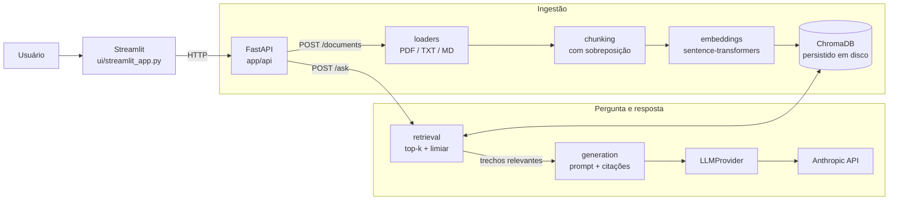

# 📚 DocChat

**Chat com seus documentos usando RAG (Retrieval-Augmented Generation).** Envie PDFs, TXTs ou Markdown, faça perguntas em português e receba respostas baseadas *somente* nos documentos, com as fontes citadas. Se a informação não estiver neles, o sistema diz que não encontrou, em vez de inventar.

Projeto de portfólio, feito para ser pequeno, legível e fácil de explicar: cada etapa do pipeline é uma classe simples, sem frameworks de orquestração de LLM.


---

## O problema

LLMs respondem com fluência, mas sem acesso aos *seus* documentos e com tendência a "completar" lacunas com informação inventada (alucinação). O DocChat resolve isso com RAG:

1. busca os trechos dos documentos mais relevantes para a pergunta;
2. entrega só esses trechos ao LLM, instruindo-o a responder apenas com base neles;
3. devolve a resposta junto com as fontes (arquivo, página e trecho), para que o usuário possa conferir.

## Funcionalidades

- Upload e indexação de **PDF, TXT e Markdown**, com metadados (arquivo, página, chunk).
- **Busca semântica** com top-k configurável e **limiar de similaridade**.
- **Resposta com citações**: arquivo, página e trecho usado.
- **Resposta "não sei"**: quando nenhum trecho passa do limiar, ou quando o LLM não encontra a resposta no contexto, a resposta é uma mensagem explícita de que a informação não está nos documentos.
- **Camada de LLM plugável**: interface única (`LLMProvider`) com o provedor da Anthropic implementado; adicionar outro é criar uma classe e registrá-la na factory.
- **API REST** (FastAPI) e **interface de chat** (Streamlit) com as fontes de cada resposta em um expander.
- Execução local com **Docker Compose**.

## Arquitetura



### Estrutura do projeto

```
app/
├── api/         # FastAPI: main.py (app e erros), routes.py (endpoints), deps.py (injeção)
├── services/    # loaders, chunking, embeddings, vector_store, ingestion, retrieval, generation
├── llm/         # base.py (interface), anthropic_provider.py, factory.py
└── core/        # config.py (variáveis de ambiente), models.py (schemas), exceptions.py, logging.py
ui/              # interface Streamlit
eval/            # documentos de exemplo, questions.json, run_eval.py, results.md
tests/           # pytest: chunking, ingestão, retrieval, API
```

## Como rodar

Pré-requisitos: Python 3.11+ e uma chave da API da Anthropic.

```bash
# 1. clonar e instalar
git clone https://github.com/belyisa-bit/DocChat.git && cd DocChat
python -m venv .venv && source .venv/bin/activate
pip install -r requirements.txt

# 2. configurar (edite o .env e coloque sua ANTHROPIC_API_KEY)
cp .env.example .env

# 3. subir a API (porta 8000) e, em outro terminal, a interface (porta 8501)
python -m uvicorn app.api.main:app --port 8000
streamlit run ui/streamlit_app.py
```

Com Docker:

```bash
docker compose up --build
# API: http://localhost:8000  |  Interface: http://localhost:8501
```

A documentação interativa da API (Swagger) fica em `http://localhost:8000/docs`.

## Configuração

Tudo é configurado por variáveis de ambiente (veja `.env.example`). **Nunca** commite o arquivo `.env` com chaves reais.

| Variável | Padrão | Descrição |
|---|---|---|
| `LLM_PROVIDER` | `anthropic` | Provedor de LLM (escolhido na factory) |
| `ANTHROPIC_API_KEY` | – | Chave da API da Anthropic |
| `LLM_MODEL` | `claude-3-5-sonnet-20241022` | Modelo usado nas respostas |
| `LLM_TEMPERATURE` | `0.0` | Temperatura (0 = respostas mais determinísticas) |
| `LLM_MAX_TOKENS` | `1000` | Tamanho máximo da resposta |
| `EMBEDDING_MODEL_NAME` | `sentence-transformers/all-MiniLM-L6-v2` | Modelo de embeddings (local) |
| `CHROMA_PERSIST_DIRECTORY` | `./chroma_db` | Pasta onde o ChromaDB persiste os dados |
| `CHROMA_COLLECTION_NAME` | `docchat_collection` | Nome da coleção |
| `CHUNK_SIZE` / `CHUNK_OVERLAP` | `500` / `50` | Tamanho do chunk e sobreposição, em caracteres |
| `RETRIEVAL_TOP_K` | `4` | Quantidade de trechos recuperados |
| `SIMILARITY_THRESHOLD` | `0.3` | Similaridade mínima para um trecho ser usado |

## Exemplos de uso da API

**Health check**

```bash
curl http://localhost:8000/health
```

**Enviar um documento** (`.pdf`, `.txt` ou `.md`)

```bash
curl -X POST http://localhost:8000/documents \
  -F "file=@meu_documento.pdf"
```

```json
{
  "filename": "meu_documento.pdf",
  "chunks_created": 42,
  "status": "success",
  "message": "Documento ingerido e indexado com sucesso."
}
```

**Fazer uma pergunta**

```bash
curl -X POST http://localhost:8000/ask \
  -H "Content-Type: application/json" \
  -d '{"question": "Qual é o prazo de entrega?", "top_k": 3}'
```

```json
{
  "question": "Qual é o prazo de entrega?",
  "answer": "O prazo de entrega é de 10 dias úteis. [meu_documento.pdf, página 2]",
  "citations": [
    {
      "document_id": "meu_documento.pdf",
      "page_number": 2,
      "snippet": "O prazo de entrega é de 10 dias úteis a partir da confirmação..."
    }
  ],
  "timestamp": "2026-10-31T12:00:00"
}
```

Quando a resposta não está nos documentos:

```json
{
  "question": "Quem ganhou a Copa de 2010?",
  "answer": "Não encontrei informações suficientes nos documentos fornecidos para responder a essa pergunta.",
  "citations": []
}
```

Um arquivo com extensão não suportada retorna `400`; falhas no processamento ou no LLM retornam `500` com a descrição do erro.

## Como funciona (pipeline)

**Ingestão**: `loaders` extrai o texto (página a página nos PDFs) → `chunking` divide em pedaços com sobreposição, mantendo arquivo e página → `embeddings` gera um vetor por chunk → `vector_store` salva tudo no ChromaDB.

**Pergunta**: `retrieval` gera o embedding da pergunta, busca os top-k chunks e descarta os abaixo do limiar de similaridade → `generation` monta o prompt com os trechos (identificados por documento e página), chama o LLM e devolve a resposta com as citações.

**"Não sei" em duas camadas**

1. *Antes do LLM:* se nenhum chunk passa do limiar, o LLM nem é chamado e a resposta padrão é devolvida (menos custo e menos risco de alucinação).
2. *No prompt:* o system prompt instrui o LLM a responder com uma frase fixa quando o contexto não bastar, e a não usar conhecimento externo.

## Decisões técnicas

- **Sem LangChain no pipeline de RAG.** Cada etapa é uma classe pequena com dependências injetadas, o que deixa o fluxo explícito e fácil de testar com mocks. (A única exceção é o `RecursiveCharacterTextSplitter` da biblioteca `langchain-text-splitters`, usado só para dividir texto respeitando parágrafos e frases.)
- **Chunks de 500 caracteres com 50 de sobreposição.** Chunks pequenos geram vetores mais focados em uma ideia, o que melhora a precisão da busca; a sobreposição evita cortar uma informação no meio e perder o contexto entre dois chunks. O tamanho também cabe com folga na janela de entrada do modelo de embeddings.
- **sentence-transformers rodando localmente.** Sem custo por chamada, sem enviar o conteúdo dos documentos a um serviço de embeddings e sem dependência de rede na busca. O modelo `all-MiniLM-L6-v2` é leve e rápido (veja a limitação sobre português abaixo).
- **ChromaDB.** Banco vetorial embutido, persistido em disco, sem servidor para administrar. Ideal para um projeto local; a coleção usa distância de cosseno, convertida em similaridade (`1 - distância`) para aplicar o limiar.
- **Limiar de similaridade configurável.** Permite recusar perguntas fora do escopo antes de gastar uma chamada ao LLM. O valor padrão (`0.3`) é um ponto de partida e deve ser calibrado com a avaliação.
- **Interface `LLMProvider` + factory.** Trocar ou adicionar provedores não altera o restante do código: basta implementar `generate_response` e registrar a classe em `app/llm/factory.py`.
- **Temperatura 0.** Respostas mais estáveis e reproduzíveis, desejável quando a resposta deve seguir o texto.

## Testes

```bash
pytest
```

Os testes ficam em `tests/` e cobrem chunking, ingestão, retrieval e os endpoints da API. A chamada ao LLM deve ser mockada nos testes, para que rodem sem rede e sem custo.

## Avaliação

A pasta `eval/` reúne o conjunto de avaliação do RAG:

- `eval/docs/`: documentos de exemplo em português;
- `eval/questions.json`: perguntas com o arquivo/trecho esperado e uma resposta de referência, incluindo perguntas **sem resposta** nos documentos;
- `eval/run_eval.py`: calcula as métricas e grava `eval/results.md`.

| Métrica | O que mede | Resultado |
|---|---|---|
| Hit rate @k | O chunk correto apareceu entre os top-k recuperados? | _a preencher_ |
| Taxa de recusa correta | Nas perguntas sem resposta, o sistema disse que não sabia? | _a preencher_ |
| Latência média | Tempo médio por pergunta | _a preencher_ |

> Os números acima serão preenchidos com a saída de `eval/results.md` depois da primeira execução do script.

## Limitações e próximos passos

**Limitações atuais**

- O modelo de embeddings padrão (`all-MiniLM-L6-v2`) é treinado majoritariamente em inglês. Para documentos em português, o ideal é um modelo multilíngue, como `paraphrase-multilingual-MiniLM-L12-v2`, trocando só `EMBEDDING_MODEL_NAME` (e reindexando os documentos).
- A API expõe `GET /health`, `POST /documents` e `POST /ask`. Listar e remover documentos (`GET /documents`, `DELETE /documents/{id}`) ainda não existem.
- O chunking é por caracteres, sem considerar a estrutura do documento (títulos, tabelas). PDFs escaneados (imagens) não são suportados, pois não há OCR.
- A URL da API na interface Streamlit está fixa em `http://127.0.0.1:8000`; dentro do Docker Compose ela precisa apontar para o serviço `api`.
- Não há autenticação, limite de tamanho de upload nem histórico de conversa enviado ao LLM (cada pergunta é independente).
- Só há provedor da Anthropic implementado.


## Autora

Feito por [belyisa-bit](https://github.com/belyisa-bit).

## Licença

Veja o arquivo [LICENSE](LICENSE).
